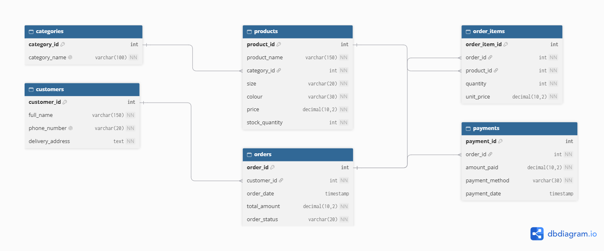

# Portfolio 1: Database Design and Modelling

**Case study:** Ikojn, an online store for 100% Made-in-Kenya women's wear.
**Database:** MySQL 8.0 (`ikojn_db`)

## Files in this folder
- `er-diagram.png,png`: entity-relationship diagram
- `schema.sql`: SQL script that creates the tables

## ER diagram

## Design notes
(to be completed)
